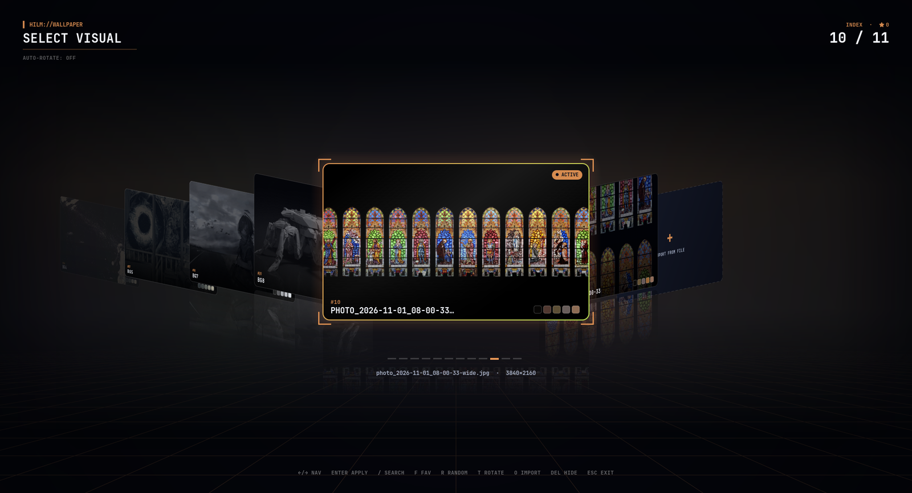

# omarchy-hilm

```
     ▄█▄▄
      █████████                █████          ▄▄███████████████████▄
      ▀▀▀▀▀████                 █████       ▄████████████████████████
           ████               ▄██████▄      █████  █████  █████  █████
       ▄▄▄█████▄▄▄▄         ██████████▄    █████   █████  █████▄▄████▀
     ████████████████▄     ████▀  ▀████▄    █████▄▄█████  ██████████▀
   ▄█████▀▀████▀▀█████▄   █████▄▄▄ ▀████▄   ▀███████████  ▀▀▀▀▀▀▀▀▀
   █████   ████   █████   █████████ ▀████▄     ▀▀▀█████
   █████   ████   █████  █████ ████▀ ▀████       █████
   █████   ████   █████  ██████████   █████     █████
   ▀▀▀▀▀   ▀▀▀▀   ▀▀▀▀▀  ▀▀▀▀▀▀▀▀      ▀▀▀▀▀   ▀▀▀▀▀
```

> *hilm* (ሕልም): Amharic for "dream".



A futuristic cover-flow wallpaper picker for [Omarchy](https://omarchy.org).

Your wallpapers show as holographic cards with a neon frame in your theme's accent colour. Moving between cards previews each one live on your real desktop. When you pick one, your **whole system is re-themed from its colours**: terminal, Waybar, borders, btop and the rest.

## Install

```bash
curl -fsSL https://raw.githubusercontent.com/Dagmawi-M/omarchy-hilm/main/install.sh | bash
```

or, if you'd rather read it first:

```bash
git clone https://github.com/Dagmawi-M/omarchy-hilm
cd omarchy-hilm
./install.sh
```

Then press **SUPER + CTRL + SPACE**.

### The install wizard

The installer is a short guided wizard:

1. **Scan.** Checks your Omarchy version, what's already installed and which features you'll get.
2. **Wallpaper folder.** If you already have `~/.config/omarchy/wallpapers`, it uses that. Otherwise it lists the image folders it finds (`~/Pictures/Wallpapers`, `~/Pictures` and so on) with how many images each holds. You can also create the Omarchy folder or type any path.
3. **Summary.** Shows exactly what will change before anything happens.
4. **Install.** Runs each step with live progress.

Your wallpapers are only ever **read**: never moved, renamed or deleted.

Running the installer again updates the picker and keeps your settings.

| Flag | Effect |
|---|---|
| `--yes` | Use all the defaults, no questions asked |
| `--dir ~/Pictures/Walls` | Use this wallpaper folder |
| `--no-keybind` | Don't add the shortcut |

### What it changes

- Installs any missing packages from the official Arch repos: `python-gobject`, `gtk3`, `gtk-layer-shell`, `imagemagick`, `swaybg`, `ffmpegthumbnailer` and `libnotify`.
- Copies three scripts into `~/.local/bin`.
- Saves your settings in `~/.config/omarchy-hilm/`.
- Adds one shortcut block to your Hyprland bindings and backs that file up first.
  - The block takes over **SUPER + CTRL + SPACE**, which Omarchy uses for "next background" by default.

It doesn't touch system files, your other themes, or any other configs.

### Compatibility

hilm detects your Omarchy version and adapts automatically. You don't need to configure anything.

| Omarchy | What you get |
|---|---|
| 4.x (Lua config, `omarchy-shell` background) | Full re-theme, shortcut set in `bindings.lua`, video wallpapers built in |
| 3.x (`colors.toml` templates, `swaybg`) | Full re-theme, shortcut set in `bindings.conf`. Video wallpapers need `mpvpaper` |
| Older | Wallpaper only. Run `omarchy-update` to get re-theming |

Re-theming creates its own theme called `hilm`. Your existing themes are never modified, so you can switch back from the Omarchy theme menu (**SUPER + SHIFT + CTRL + SPACE**) at any time.

## Controls

| Key | Action |
|---|---|
| ← / → , h / l, scroll | Move between cards |
| Enter / Space / click | Apply |
| `/` | Search by name |
| `f` | Favourite (★ favourites sort first) |
| `r` | Random spin |
| `t` | Turn auto-rotate on or off |
| `o` | Import an image or video |
| Del (twice) | Hide from the picker (the file stays on disk) |
| Esc / q / right-click | Cancel and restore the previous wallpaper |

## Extras

- **Video and GIF wallpapers:** these work out of the box on Omarchy 4. On Omarchy 3, install `mpvpaper` first with `yay -S mpvpaper`. Then import or drop `.mp4`, `.webm`, `.mkv`, `.mov` or `.gif` files into your wallpaper folder.
- **Auto-rotate:** `omarchy-hilm-rotate on|off|next|interval <minutes>`. It rotates through your favourites, or the whole pool if you have none. The default interval is 30 minutes.
- **Adding wallpapers:** put images in your wallpaper folder (subfolders up to 2 levels deep are included), or use the Import card. Importing copies the file into your folder and never overwrites anything.
- **Changing folders:** run the installer again, or edit `WALLPAPER_DIR` in `~/.config/omarchy-hilm/config`.
- **Unhiding wallpapers:** delete the line from `~/.config/omarchy-hilm/hidden`, or delete the whole file to unhide everything.

## Troubleshooting

| Problem | Fix |
|---|---|
| Package install fails | Run `sudo pacman -Syu` (or `omarchy-update`), then run the installer again |
| Shortcut opens Omarchy's own background switcher | Run the installer again to update. Older hilm versions didn't support Omarchy 4's Lua config |
| Shortcut does nothing | Run `hyprctl reload`, or run `omarchy-hilm` in a terminal to see errors |
| Thumbnails look wrong after editing an image | Delete `~/.cache/omarchy-hilm` |
| Want your old theme back | Use the Omarchy theme menu (**SUPER + SHIFT + CTRL + SPACE**) |

## Uninstall

```bash
~/.local/share/omarchy-hilm/uninstall.sh
```

This removes the scripts, the shortcut, the thumbnail cache and the auto-rotate timer. Your wallpapers, favourites and settings are kept.

## License

MIT
